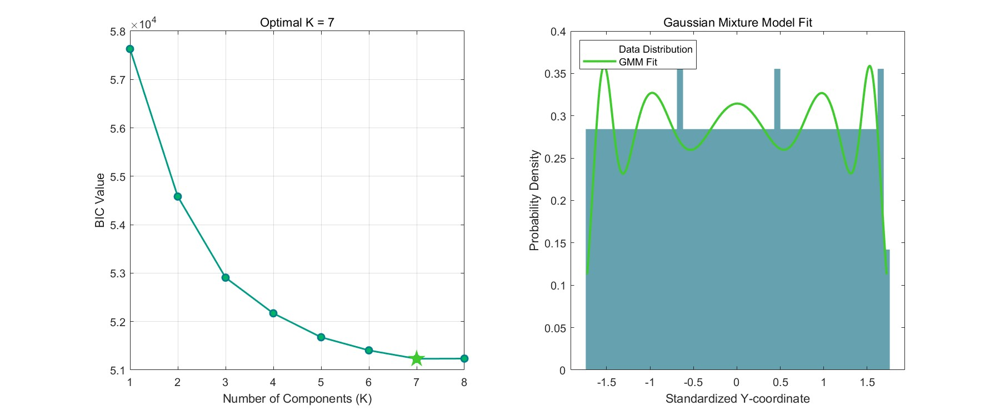

# 2025 MCM · 台阶磨损建模与可视化

**通过磨损表面、统计拟合与敏感性分析，研究台阶使用痕迹。**

| 项目 | 信息 |
| --- | --- |
| 类型 / 时间 | 2025年美国大学生数学建模竞赛（MCM） |
| 我的职责 | 程序构建、模型设计与优化、结果可视化 |
| 成果 | 团队获S奖（Successful Participant） |
| 技术 | MATLAB · GMM / BIC · 三维曲面、热力图、截面与敏感性分析 |

仓库文档与展示结构整理有 AI 辅助参与。

## 工作与成果

- 构建磨损表面与改进Archard相关模型，编写参数分析程序。
- 标准化数据，使用GMM拟合及BIC选择模型复杂度。
- 制作三维磨损曲面、平面热力图与截面图，帮助解释模型结果。
- 开展参数敏感性与蒙特卡洛分析，形成代码与系列可视化材料。

## 快速体验

在MATLAB切换到 `matlab/` 后执行 `run_demo`。它调用 `Archard2` 生成合成磨损样例，再执行GMM/BIC及体积分析。GMM与 `zscore` 等功能需要Statistics and Machine Learning Toolbox。

示例曲面为模型仿真，不将其标记为实测扫描结果。原始MAT/PLY数据与团队论文未附入公开仓库，原脚本中的经验参数与单位仍应结合研究背景解释；本次整理未在MATLAB中重新执行全套模型。

## 代码导航

- `Archard.m`、`Archard2.m`、`input1.m`：磨损曲面与截面研究。
- `BIC_K.m`：GMM拟合及BIC选择。
- `outv.m`：网格体积计算。
- `lmdfx.m`、`lmdfx2.m`：敏感性及参数研究。
- `ansys.m`：使用次数相关模型。

这是团队参赛项目，不将团队成果表述为个人独立完成。查看 [验证说明](docs/VALIDATION.md) 与 [简历填写](docs/RESUME.md)。
